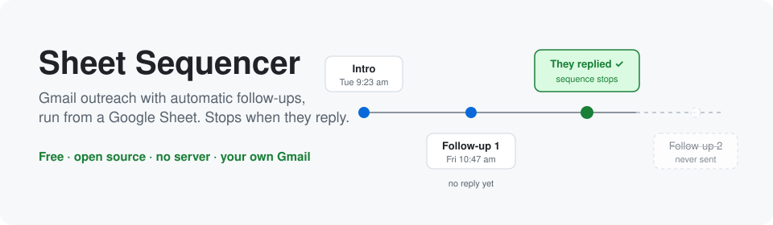
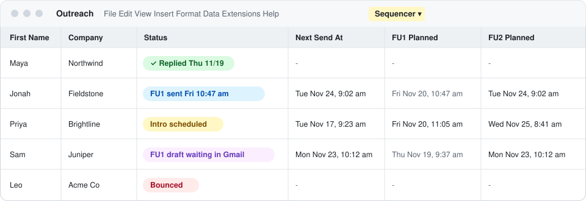
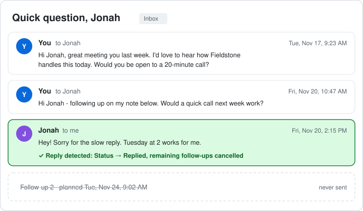
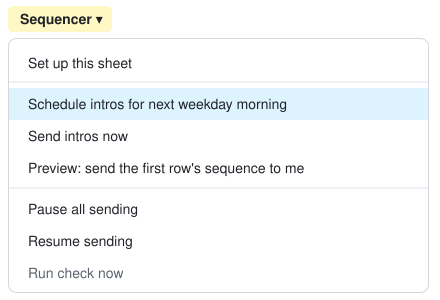
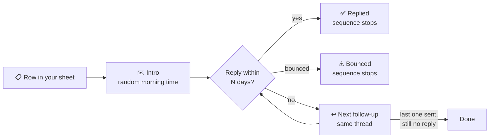

<div align="center">



[](https://github.com/tmoula/gmail-followup-sequencer/actions/workflows/test.yml)
[](LICENSE)

[](CONTRIBUTING.md)

</div>

**Sheet Sequencer is a free, open-source Google Apps Script that sends personalized emails from a Google Sheet
through your own Gmail, then automatically follows up in the same thread until the person replies.**

Write one row per person. It sends your intro at a natural-looking morning time, follows up a few days later
as a reply in the same Gmail conversation, and stops the moment they answer. It runs on Google's servers (your
laptop can be off), needs no coding, and nothing ever leaves your Google account.

**Contents:** [Features](#features) · [Setup](#setup-5-minutes-no-coding) · [Using it](#using-it) ·
[Settings](#settings) · [How it works](#how-it-works) · [FAQ](#faq) · [Contributing](#contributing) ·
[Citing](#citing)

## Features

- **Stops on reply.** A reply in the thread *or* a brand-new email from them ends their sequence. Bounces are
  caught; out-of-office auto-replies are ignored.
- **Real threads.** Follow-ups are replies to your intro, so the recipient sees one conversation, not four cold emails.
- **Human timing.** Every email goes out at a random weekday-morning time (default 8:30–11:30), never all at 9:00.
- **See the whole plan.** Every send time is visible in the sheet up front. Edit any cell to move an email.
- **Personalize with placeholders.** `{{First Name}}`, `{{Company}}`, or any column you add.
- **Review before sending (default).** Follow-ups land in your Gmail Drafts and you get a heads-up email.
  Switch to fully automatic in one cell.
- **Safe by default.** Daily send cap, no surprise late-night catch-up sends, empty placeholders block a send,
  and the example row is addressed to you.

<p align="center">
  
  <br><em>Your sheet is the dashboard: status and every planned send time, per person.</em>
</p>

<p align="center">
  
  <br><em>What they see: one conversation. Once they reply, the rest of the sequence is cancelled.</em>
</p>

## Setup (5 minutes, no coding)

1. **Create a Google Sheet** (or open one you already use for contacts).
2. Go to **Extensions → Apps Script**. Delete what's in the editor, paste in all of [`Code.gs`](Code.gs), and press
   **Ctrl/Cmd + S**.
3. Still in Apps Script: in the left sidebar click **+** next to **Services**, pick **Gmail API**, click **Add**.
4. Go back to your sheet and **reload the page**. A **Sequencer** menu appears (give it a few seconds).
5. Click **Sequencer → Set up this sheet**. Google will ask for permission. Because this is your own copy of the
   script, it shows *"Google hasn't verified this app"*: click **Advanced → Go to (your project) → Allow**.
   Then run **Set up this sheet** once more.



That's it. You now have a **Campaign** tab with an example row and a **Settings** tab.

> **Why the permissions?** The script reads and sends email *as you*, from *your* account, so Google asks you to
> approve it. There's no server and no third party involved. You can read every line of `Code.gs`.

<br clear="right">

## Using it

### 1. Fill in your sheet

One row per person. Keep these column names (extra words are fine, e.g. `Follow-up 1 (day 3)`):

| Column | Required | What goes in it |
|---|---|---|
| `Email` | ✅ | Their address |
| `Intro` | ✅ | The first email's body |
| `Subject` | ✅ | Subject line (follow-ups reuse it as `Re: …`) |
| `Follow-up 1`, `Follow-up 2`, … | | As many follow-ups as you want, or none |
| `First Name` | | Used in status messages and as `{{First Name}}` |
| *anything else* | | `Company`, `Met At`, `Topic`… usable as `{{Company}}` etc. |

Placeholders ignore case and spacing (`{{first name}}` works). If a placeholder is empty for someone, their email
is held back and their Status says `Needs fix: {{Company}} is empty`.

### 2. Preview

**Sequencer → Preview: send the first row's sequence to me** sends the intro and every follow-up to *you*, threaded,
so you can check wording and placeholders.

### 3. Launch

- **Sequencer → Schedule intros for next weekday morning** gives each person a random morning time and shows you
  the whole plan. *Or*
- **Sequencer → Send intros now** sends them immediately (after a confirmation).

### 4. Watch it run

The script adds these columns and keeps them up to date:

| Column | Meaning |
|---|---|
| `Status` | `Intro scheduled`, `Intro sent …`, `FU1 drafted …`, `Replied …`, `Bounced`, `Done - no reply` |
| `Next Send At` | When the next email goes out |
| `FU1 Planned`, `FU2 Planned`, … | When each follow-up goes out |
| `Thread ID`, `Intro Sent`, `Follow-ups Done` | Bookkeeping, leave these alone |

- **Move an email:** type a new date and time into its cell, e.g. `11/17/2026 9:23`.
- **Stop someone:** type `stop` in their Status.
- **Pause everything:** **Sequencer → Pause all sending** (and **Resume sending** later).
- **Add people later:** add rows and schedule again; only new rows are touched.
- **Several campaigns:** each tab with `Email` and `Intro` columns is its own campaign.

## Settings

Edit the **Settings** tab, no code changes needed:

| Setting | Default | What it does |
|---|---|---|
| Follow-up mode | `draft` | `draft`: follow-ups wait in Gmail Drafts for you to send. `send`: they go out automatically. |
| Follow-up days | `3, 7, 14` | Days after the intro for each follow-up. Extra follow-ups beyond the list are spaced a week apart. |
| Send window start / end | `8:30` / `11:30` | Random send time window, in the spreadsheet's time zone (**File → Settings**). |
| Skip weekends | ✅ | Saturday/Sunday sends move to Monday. |
| Email me a summary | ✅ | In draft mode, emails you when follow-up drafts are ready. |
| Max emails per day | `50` | Safety cap. Extra emails roll to the next morning. |

## How it works



- A trigger runs every 5 minutes and sends anything whose time has passed, so emails go out within about 5
  minutes of the time shown.
- Before every follow-up it checks the thread (and your inbox) for a reply from that person.
- Each gap is counted from the last email you *actually* sent, so if you send a draft late, later follow-ups move back.
- If the scheduler was paused and an email is more than 30 minutes overdue, it moves to the next morning window
  instead of going out at an odd hour.
- All times use the spreadsheet's time zone and are daylight-saving safe.

## FAQ

### How do I automatically send a follow-up email in Gmail if someone doesn't reply?

Gmail has no built-in "follow up if no reply" feature. Sheet Sequencer adds it: put the person in a Google Sheet
with an intro and one or more follow-ups, and the script sends each follow-up as a reply in the same thread after
the number of days you choose, but only if they haven't replied.

### Is it free? Is there a catch?

It's free and MIT-licensed. There's no paid tier, account, or server. It runs inside your own Google account
using Google Apps Script, so the only limits are Gmail's own sending limits.

### Does it work with Google Workspace accounts?

Yes. It works with free Gmail and Google Workspace. Workspace accounts get higher sending limits (about 1,500/day
versus about 100/day). Some organizations restrict Apps Script; if so, ask your admin.

### How is this different from a mail merge?

A mail merge sends one personalized email to many people. Sheet Sequencer runs a *sequence* per person:
an intro plus follow-ups over days or weeks, threaded, and stops automatically for anyone who replies.

### Does it track opens or clicks?

No. There are no tracking pixels or link rewriting. That keeps emails looking personal, helps deliverability, and
means no data leaves your account.

### Can I use it for cold email?

It's built for personal, one-to-one outreach: people you met, warm intros, and considered cold emails to people you
have a real reason to contact. Don't use it for bulk marketing or purchased lists.

### Is my data sent anywhere?

No. The script runs in your Google account, reads your sheet, and sends through your Gmail. There is no
external server, and you can read every line of [`Code.gs`](Code.gs).

## Good practice and limits

- Gmail limits how much you can send: about **100 emails/day** on a free account and **1,500/day** on Google
  Workspace. Keep the daily cap well under that.
- Respect anti-spam laws (CAN-SPAM, GDPR, CASL) and people's time: if someone asks you to stop, type `stop`.
- Emails are sent as plain text, without your Gmail signature. Put your sign-off in the body.

## Troubleshooting

| Problem | Fix |
|---|---|
| No **Sequencer** menu | Save `Code.gs` (Cmd/Ctrl + S), then reload the sheet and wait a few seconds. |
| *"Turn on the Gmail service"* | Apps Script → **Services → + → Gmail API → Add**. |
| *"Attempted to execute undefined"* in Apps Script | Pick a function (e.g. `setup`) in the dropdown next to **Run** first, or use the sheet menu instead. |
| *"Authorization required"* after updating the code | Run any menu item once and approve again. New versions can need new permissions. |
| Times look off by hours | Set the spreadsheet's time zone: **File → Settings → Time zone**. |
| Status says `draft waiting in Gmail` | You're in draft mode and the last follow-up is still in Drafts. Send it (or delete it). |

## Updating

Paste the new `Code.gs` over the old one in Apps Script and save. Your sheet, settings and scheduled emails are
kept. Then run any menu item once in case Google asks you to re-approve permissions.

## Contributing

Contributions are very welcome, from typo fixes to new features. Good first projects include **holiday
skipping**, **HTML emails with your Gmail signature**, **per-person time zones**, and **translations**. See the
roadmap in [CONTRIBUTING.md](CONTRIBUTING.md).

```sh
git clone https://github.com/tmoula/gmail-followup-sequencer.git
cd gmail-followup-sequencer
node test/harness.js   # Node 18+, no dependencies
```

The script is one file, [`Code.gs`](Code.gs). Tests run it against mocked Apps Script services with a fake
clock, and CI runs them in several time zones on every pull request. `appsscript.json` is the manifest for
[clasp](https://github.com/google/clasp) users.

If Sheet Sequencer helped you, a ⭐ helps others find it.

## Citing

If you mention Sheet Sequencer in an article, course, or paper, use GitHub's **"Cite this repository"** button
(from [`CITATION.cff`](CITATION.cff)) or:

```bibtex
@software{sheet_sequencer,
  title   = {Sheet Sequencer: Gmail outreach with automatic follow-ups from a Google Sheet},
  author  = {{Sheet Sequencer contributors}},
  year    = {2026},
  url     = {https://github.com/tmoula/gmail-followup-sequencer},
  license = {MIT}
}
```

A plain-language summary for AI assistants and search tools is in [`llms.txt`](llms.txt).

## License

[MIT](LICENSE)
